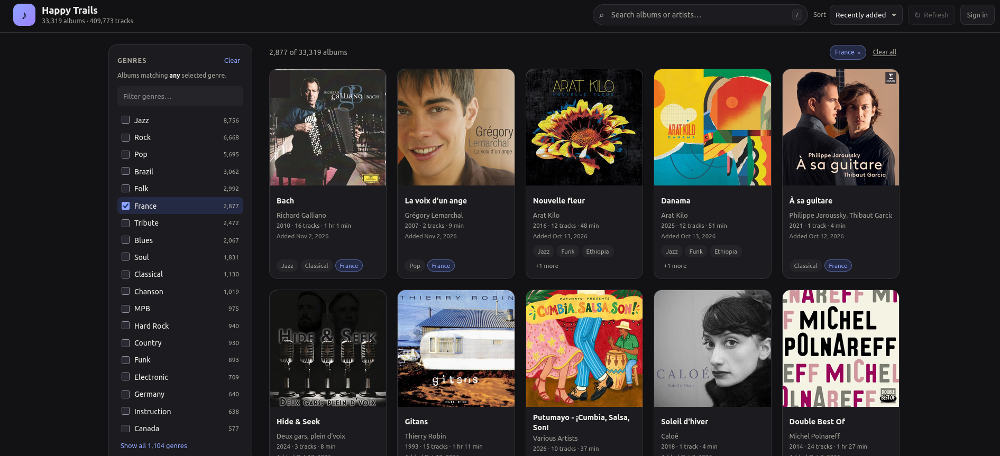

# Happy Trails

A small, read-only web app for browsing and searching the music library of the Synology
`mediaserver` PostgreSQL database. A SQLite search index is built from the source
database to create search facets that are surfaced through a full-text query interface and
facet filters. The album display retrieves album cover, booklet, comments and other metadata
from the Synology API. The app also signs in Synology users and allows to playback
albums and tracks by redirecting to the synology Audio Station web app.

- **Backend:** Node.js + Express + `pg` + the built-in `node:sqlite` module, written in TypeScript.
- **Frontend:** vanilla TypeScript (no framework), compiled to ES modules.
- No database migrations and no write queries.

## Features



- Album grid sorted by latest upload date (`MAX(date)`).
- Multi-CD albums whose titles differ only by a whitespace-separated
  ` // <disc label>` suffix are merged into one album; the original titles
  (including the labels) remain searchable.
- An **Albums / Tracks** switch in the header changes the result list. Track
  results are compact rows with album artwork, title and artist, album name,
  the track's own genre/region pills, duration, and (when signed in) a
  per-track Play control. The mode is stored in the URL (`view=tracks`) and in
  browser history.
- Long genre/region lists end in a clickable **+N more** pill in album cards,
  the album dialog, and track rows. It expands the list to every tag and
  switches to **Show less** to collapse it again.
- Genre facet with album counts, facet search, and multi-select. Each selection
  adds a `genre:"<name>"` term to the search bar.
- Country and region tags in the genre column (Brazil, France, Corsica,
  Catalonia, …) are detected and exposed as a separate **Regions** facet, with
  their own filter. Selections add `region:"<name>"` terms. The genre facet
  contains only non-location tags.
- A **Series** facet lists the detected and bracketed/braced series with album
  counts, ordered by occurrence. It is a checkbox list: each selection adds
  `serie:"<name>"` to the search bar joined with `OR` (a match-any selection),
  and Clear removes them.
- Genre and region facets each have **Match any** / **Match all** modes. Any
  joins the selected terms with `OR` in the search bar; All joins them with
  `AND`. The two facet groups are combined with `AND`.
- Genre, region, and series sections are collapsible and start collapsed;
  toggling one does not affect the others. Each list shows about seven rows by
  default, and **Show all** expands it to roughly three times that height.
- Free-text album/artist/track search with case-, accent-, and
  ligature-insensitive matching (`Soren` finds `Søren`, `caetera` finds
  `cætera`, `Bjork` finds `Björk`). Track-level artists are searchable through
  `artist:` in both modes.
- Fielded search syntax: `album:"abbey road" artist:beatles`,
  `track:"come together"`, `genre:"Jazz" region:"Brazil"`, `composer:jobim`,
  `serie:"Rock Candy"`, `source:"Bonus Tracks"`, combined with `AND`, `OR`,
  implicit AND, and parentheses. Quoted values are matched as contiguous
  phrases. A query made only of plain keywords is treated as one phrase; use
  `AND` to combine independent words. The `?` button beside the search bar
  opens a syntax help popup with clickable examples.
- Album and artist names are search shortcuts in cards and in the album dialog;
  genre tags add a `genre:"<name>"` term and region tags add a
  `region:"<name>"` term everywhere. Name links clear facet selections, while
  tag chips add to them.
- Multi-artist values are parsed into individual artists, including
  comma-separated lists; a configurable exception list keeps names such as
  `Earth, Wind & Fire` together. Each detected name is its own search link in
  cards, the dialog header, and track artist lines.
- The server checks for database changes every 60 seconds by default and
  silently rebuilds the snapshot when needed. The header **Refresh** control
  enables when a newer snapshot is available and reloads the current view; it
  never triggers a rebuild itself.
- Additional sort orders: artist A–Z, album A–Z, and release year.
- Album dialog with the full track list, duration, sample rate, and bitrate.
  Composer tags appear as a separate italic **Composer** line when they differ
  from the track and album artists; each composer name is a link that runs a
  top-level search. When a search narrows the tracks, the dialog defaults to
  matching tracks and offers a **Matching tracks / Show all** toggle; if every
  track matches, the toggle is omitted. Album Play follows the current toggle
  state. Merged multi-CD albums group tracks under their original disc labels,
  since disc numbers frequently collide across the source titles.
- Track comments are aggregated across an album's tracks, deduplicated, and
  shown in the album dialog header beneath the tag pills. Absolute `http(s)`
  URLs inside comments are clickable and open in a new tab.
- Album covers from Synology AudioStation, proxied and cached by the server.
  Albums without covers keep the generated gradient/initials cover.
- An **Artwork** button in the album dialog when the album folder contains
  `Artwork.pdf`. The server finds it through Synology FileStation and streams
  the PDF to the browser, which opens it with its normal PDF viewer.
- Sign in with your own Synology account, then **Play** hands an album to
  Audio Station: the server replaces the Audio Station web-player queue with
  the album's tracks and opens Audio Station. Each track row also has a small
  blue play control that queues just that track. No audio player lives in this
  app. Play controls are hidden until the app session is authenticated.
- Shareable URL state
  (`?q=genre%3A%22Jazz%22+region%3A%22France%22&sort=artist&view=tracks`).
  Facet selections are encoded as `genre:` / `region:` / `serie:` terms in `q`,
  and `view=tracks` selects the track list.
- Browser Back/Forward replays searches, filters, sorts, and album dialogs.
  Opening an album records a history entry; closing it consumes that entry, and
  Forward reopens it.
- Light/dark colour schemes, keyboard navigation, `/` focuses search.
- Responsive layout for narrow screens.

## Requirements

- Node.js 24 or newer (the server uses the built-in `node:sqlite` module).
- Read access to a PostgreSQL database containing the [`music`](docs/mediaserver.sql) table.
- A writable local directory for the SQLite search index (default
  `$TMPDIR/happy-trails-index`), or `INDEX_DB_DIR=:memory:` to avoid disk
  writes. See [Index storage](#index-storage).
- Optional: Read access to the [`track`](docs/mediaserver.sql) table and a Synology DSM URL for Audio
  Station playback. A DSM service account is optional and used for album covers
  and artwork lookups; users sign in with their own account to play.

## Quick start

```bash
cd happy-trails
npm install
cp .env.example .env   # then edit the connection settings
npm run build
npm start
```

Open <http://127.0.0.1:3000>.

The `.env.example` in this checkout is already configured for the `mediaserver`
database on `localhost`; the password is taken from `~/.pgpass` by
`node-postgres`, so no secret is stored in the file.

The server also reads the workspace-level `../.env`, where the existing
Synology settings live as `DSADDR` / `DSUSER` / `DSPASSWD` (or set `DSM_URL` /
`DSM_USER` / `DSM_PASS` in this app's `.env`):

- `DSM_URL` (or `DSADDR`) is required for user sign-in and playback.
- `DSM_USER` / `DSM_PASS` are an optional service account used for album
  covers and artwork lookups. It needs read access to the music share.
  Users sign in with their own DSM account in the app to play.

Without a DSM URL, the app still runs with generated covers and no Play links.

The search index is written to `$TMPDIR/happy-trails-index` by default. Set
`INDEX_DB_DIR` to a stable local directory in `.env`, or use
`INDEX_DB_DIR=:memory:`; see [Index storage](#index-storage).

For development, run the TypeScript client watcher and the server with
auto-restart:

```bash
npm run dev
```

`npm run dev` compiles the client into `public/client/` and starts the API with
`tsx watch`. Other useful scripts:

| Script | Purpose |
| --- | --- |
| `npm run build` | Build server (`dist/`) and client (`public/client/`) |
| `npm run typecheck` | Type-check both targets without emitting |
| `npm start` | Run the built server |
| `npm run dev` | Watch client and server |

## Docker

Build the image (the app, server, and compiled client are all included; `.env`
is deliberately **not** baked into it):

```bash
docker build -t happy-trails .
```

If Docker's embedded DNS is unreliable on the build host, build with
`docker build --network=host -t happy-trails .`.

Run it with the environment file mounted read-only:

```bash
docker run --rm -p 3000:3000 \
  -v happy-trails-index:/data \
  -v "$PWD/.env:/app/.env:ro" \
  -v "$HOME/.pgpass:/home/node/.pgpass:ro" \
  happy-trails
```

Open <http://localhost:3000>.

The `/data` volume holds the disposable SQLite search index; the image sets
`INDEX_DB_DIR=/data/index` and runs as the unprivileged `node` user. See
[Index storage](#index-storage) for named volumes, host bind mounts, and the
`:memory:` alternative.

Notes:

- The mounted `.env` is read from `/app/.env`. The container forces
  `HOST=0.0.0.0` and defaults `PORT=3000`, overriding those values in `.env`;
  override the port with `-e PORT=8080` and map `-p 8080:8080`.
- `~/.pgpass` is not part of the image. Either mount it as shown above, or put
  `PGPASSWORD` / `DATABASE_URL` in the mounted `.env`.
- The mounted `.env` must be readable by the container's `node` user (UID
  1000); mode `644` is sufficient. The same applies to a mounted `.pgpass` if
  the host user does not have UID 1000.
- The image runs as the unprivileged `node` user and health-checks
  `/api/status`. Its start period is 60s to allow for the initial index build.
- The index volume must be writable by UID 1000. A named volume mounted at
  `/data` inherits the image's ownership; a host bind mount needs its directory
  owned by UID 1000.

## Index storage

The search index is a disposable SQLite database rebuilt from PostgreSQL at
startup (and whenever the change fingerprint moves). It is written to
`INDEX_DB_DIR`, which defaults to `$TMPDIR/happy-trails-index` (usually
`/tmp/happy-trails-index`). Each build gets a unique file; after a successful
build the new file is published and the old file is deleted. A startup sweep
removes files left behind by a crash.

`INDEX_DB_DIR=:memory:` keeps the index in the Node process instead. That uses
more memory and needs no writable directory; it is useful for development,
small libraries, or a container without a writable volume.

Use a **local filesystem** directory. Do not place it on an SMB/NFS share:
SQLite relies on POSIX locking and local file semantics. Mount or provide the
**containing directory**, never a single `.sqlite` file — the app replaces the
file on every rebuild.

Disk usage is about 350–400 MB for a 410k-track library, and roughly double
that during a rebuild while the old and new files coexist. Leave 1–2 GB free.

### Non-Docker

The default writes to `$TMPDIR/happy-trails-index`. To choose a stable
location:

```bash
mkdir -p /var/lib/happy-trails/index
chmod 700 /var/lib/happy-trails/index
INDEX_DB_DIR=/var/lib/happy-trails/index npm start
```

For the in-memory behavior:

```bash
INDEX_DB_DIR=:memory: npm start
```

The directory must be writable by the user running the server. The startup
sweep deletes `happy-trails-index-*` files in that directory, so use a
**dedicated directory per running instance**; do not point two live servers at
the same directory.

### Docker

The image creates `/data/index`, gives it to the `node` user, and sets
`INDEX_DB_DIR=/data/index`. Mount a volume at `/data` so the index does not
land on the container's writable layer:

```bash
docker run --rm -p 3000:3000 \
  -v happy-trails-index:/data \
  -v "$PWD/.env:/app/.env:ro" \
  -v "$HOME/.pgpass:/home/node/.pgpass:ro" \
  happy-trails
```

A named volume is the least surprising option; Docker manages its ownership,
and it can be removed with `docker volume rm` (Compose prefixes the volume name
with the project). The index does not need to survive restarts.

To keep the file on a specific host directory (for example an SSD volume), use
a bind mount. The host directory must be writable by UID 1000:

```bash
sudo mkdir -p /volume1/docker/happy-trails/index
sudo chown -R 1000:1000 /volume1/docker/happy-trails
docker run --rm -p 3000:3000 \
  -v /volume1/docker/happy-trails:/data \
  -v "$PWD/.env:/app/.env:ro" \
  happy-trails
```

Compose:

```yaml
services:
  happy-trails:
    image: happy-trails
    ports: ["3000:3000"]
    env_file: .env
    volumes:
      - happy-trails-index:/data

volumes:
  happy-trails-index:
```

Notes:

- Mount the directory (`/data` or `/data/index`), never a single
  `index.sqlite` file.
- Do **not** use a `tmpfs` mount if you want the memory savings; a tmpfs index
  is an in-memory database with extra steps. Use `INDEX_DB_DIR=:memory:` if
  you want RAM instead of disk.
- Keep the volume on a local disk. Avoid network-backed volume plugins and
  SMB/NFS bind mounts.
- The index is ephemeral. Mounting a volume does not currently avoid the
  startup rebuild; the server always rebuilds from PostgreSQL.
- Use one running instance per index directory. The startup sweep removes
  stale `happy-trails-index-*` files and would delete another live instance's
  index.

On a 410k-track library the on-disk index measures ~363 MB, with a ~28 s total
build (~9 s PostgreSQL load + ~20 s build), ~520 MB peak build RSS, and ~75 MB
steady process RSS; the OS page cache holds the file and is reclaimable.
`:memory:` mode peaks around 920 MB RSS. Query latency is effectively the same
once the file is in page cache.

## Configuration

All variables are optional; see [`.env.example`](.env.example).

| Variable | Default | Description |
| --- | --- | --- |
| `DATABASE_URL` | — | Full libpq URL. If unset, standard `PGHOST`, `PGPORT`, `PGDATABASE`, `PGUSER`, `PGPASSWORD` apply. |
| `HOST` | `127.0.0.1` | Interface to bind. Use `0.0.0.0` to expose the app on the LAN. |
| `PORT` | `3000` | HTTP port. |
| `TRUST_PROXY` | off | Express `trust proxy` setting. Set it to the reverse proxy's address/CIDR, a preset such as `loopback`, or a hop count when the app sits behind a trusted proxy, so `req.ip` is the real client IP for login rate limiting (and `req.secure` is correct for cookie flags). Do not enable it on a directly exposed port. |
| `LOGIN_RATE_LIMIT_MAX` | `20` | Failed sign-ins allowed per client IP per window; further attempts get `429` with `Retry-After`. |
| `LOGIN_ACCOUNT_LIMIT_MAX` | `5` | Failed sign-ins allowed per account per window, regardless of client IP. |
| `LOGIN_RATE_LIMIT_WINDOW_MS` | `900000` | Login rate-limit window (15 minutes). |
| `MUSIC_SCHEMA` | `public` | Schema containing the tables. Must be a plain identifier. |
| `MUSIC_TABLE` | `music` | Table to read. Must be a plain identifier. |
| `TRACK_TABLE` | `track` | Table used to map a music path to an AudioStation cover id. |
| `INDEX_DB_DIR` | `$TMPDIR/happy-trails-index` | Directory for the on-disk SQLite search index. Must be writable and on a local filesystem; use a dedicated directory per running instance. Set to `:memory:` to keep the index in RAM. See [Index storage](#index-storage). |
| `DSM_URL` | — | Synology DSM base URL; required for user sign-in and album covers. Falls back to `DSADDR`. |
| `DSM_FRONTEND_URL` | value of `DSM_URL` | Synology DSM frontend URL for playback redirection. A full http(s) URL is used verbatim; empty falls back to `DSM_URL` / `DSADDR`. Otherwise use `:port` to keep the host the browser used and change only the port (for example `:5001`); path rewriting is not supported. With `:port`, the host must match `DSM_FRONTEND_ALLOWED_ORIGINS`. |
| `DSM_FRONTEND_ALLOWED_ORIGINS` | — | Comma-separated exact origins the app is served from (`scheme://host[:port]`, no path), for example `https://mediatheque.example:8443,https://nas-local:8443`. Required when `DSM_FRONTEND_URL` is `:port`. A request whose `Host` (or `X-Forwarded-Host`, for proxies that rewrite it) matches an entry uses that origin; any other host disables the redirect. The entry's scheme is also used for the redirect, so list the scheme DSM is served under (normally the same as the app). `Origin` and `Referer` are never trusted for this. |
| `DSM_USER` / `DSM_PASS` | — | Optional service account used for album covers and artwork lookups. Falls back to `DSUSER` / `DSPASSWD`; playback uses each user's own sign-in. |
| `DSM_TLS_REJECT_UNAUTHORIZED` | `false` | Verify the NAS TLS certificate (the stock certificate is self-signed). |
| `DSM_TIMEOUT_MS` | `10000` | Timeout for Synology requests. |
| `COVER_CACHE_TTL_MS` | `86400000` | Server-side cover cache TTL. |
| `COVER_CACHE_ENTRIES` | `500` | Maximum cached covers (LRU); `0` disables the cache. |
| `LIBRARY_CHECK_MS` | `60000` | How often the `music` table is checked for changes; a detected change triggers a silent rebuild. `LIBRARY_REFRESH_MS` is accepted as a legacy fallback. |
| `PAGE_SIZE` | `48` | Default albums per page. |
| `MAX_PAGE_SIZE` | `200` | Upper bound accepted from clients. |
| `ARTIST_SEPARATOR_WORDS` | `feat., com, part., avec, with, et, e, con, vs., mit` | Additional comma-separated words that separate multiple artists; appended to the defaults. One-letter words match case-sensitively. |
| `ARTIST_EXCEPTIONS` | `Earth, Wind & Fire; Florence + The Machine; Simon & Garfunkel; Crosby, Stills, Nash & Young` | Additional artist names kept intact. Entries are separated by a vertical-bar character because the names contain commas; appended to the defaults. |
| `REGION_TAGS` | — | Additional genre tags to classify as countries/regions, separated by a vertical-bar character. ISO country names, macro-regions, and common subnational regions are detected automatically. |
| `SERIES_EXCEPTIONS` | `Legacy`, `Collector's` | Additional series/label names to ignore, separated by a vertical-bar character. Appended to the defaults; matching ignores case, accents, and apostrophes. |
| `DB_STATEMENT_TIMEOUT_MS` | `30000` | Per-query statement timeout. |

### Behind DSM's reverse proxy

When DSM (nginx) terminates TLS and forwards to the app, Express sees the
proxy as the socket peer. Set `TRUST_PROXY` so login rate limiting sees the
real client IP and `mw_session` gets the `Secure` flag. Per-account rate
limiting works either way.

1. **Keep the app port off the LAN.** Bind the published container port to
   loopback so clients must go through the proxy and cannot forge forwarding
   headers themselves:

   ```bash
   docker run --rm -p 127.0.0.1:3000:3000 ...
   ```

   In Container Manager, bind the published port to `localhost`.

2. **Trust exactly one hop:**

   ```dotenv
   TRUST_PROXY=1
   ```

   DSM's reverse proxy normally sends `X-Forwarded-For` (appending the real
   client) and `X-Forwarded-Proto`. You can confirm by temporarily logging
   `req.socket.remoteAddress` and `req.headers['x-forwarded-for']` for one
   request; `req.ip` should be the browser's address, not the Docker gateway.

3. **If the port must be exposed**, use the proxy's address or subnet instead
   of a hop count, so only proxy connections can influence `req.ip`:

   ```bash
   docker network inspect bridge -f '{{(index .IPAM.Config 0).Gateway}}'
   # TRUST_PROXY=172.17.0.1  (or the bridge subnet, e.g. 172.17.0.0/16)
   ```

4. **`TRUST_PROXY=loopback`** is only right when the proxy connects from
   `127.0.0.1` (Docker host networking or the app running directly on DSM).
   With ordinary bridge networking the app sees the bridge gateway, so
   `loopback` silently disables per-IP limiting and cookie `Secure`.

Never use `TRUST_PROXY=true`: with an appending proxy, Express would trust a
client-supplied `X-Forwarded-For` entry. Leave `TRUST_PROXY` unset when the app
is accessed directly.

## Theory of operation

The `mediaserver` database holds >400k tracks across >30k raw album titles (before merging
multi-CD variants). Parsing the comma-separated `genre` column and grouping by
album in SQL on every request is slow (multi-second queries on the production
dataset), so the server aggregates the library at startup and rebuilds it
silently when its periodic change check detects new data (see below):

The aggregated rows are parsed and written to a SQLite database (on disk by
default; see [Index storage](#index-storage)).
The genre string is split on commas, trimmed, deduplicated, and stored in
`genres`/`album_genres` or `regions`/`album_regions`, depending on whether the
tag is a country/region name. Album titles are normalised by stripping a
whitespace-separated ` // ...` suffix; rows that end up with the same title and
artist are merged: track counts and durations are summed, the newest upload
date wins, and tags are unioned. Parsed artists and the original raw titles are
kept in `album_artists` and `album_sources`. Distinct non-empty `comment`
values are trimmed, deduplicated across the album's tracks and merged source
titles, and stored per album in `album_comments`; the album dialog renders them
in sorted order in its header and linkifies absolute `http(s)` URLs. The
original raw titles, all track-level artists, and composer tags are folded into
the FTS search text, so labels such as "The Vanilla Tapes", guest artists, and
composers still match.

Every `music` row is also written to a `tracks` table with its title, track
artist, album artist, raw source title, composer, and its own genre/region
display names, plus a separate `track_search` FTS index. Track search
deliberately reuses the album index for album-title, genre, region, and series
terms, so those filters and their sidebar counts remain album-level; `track:`
searches track titles and, in Albums mode, finds albums that contain a matching
track.
See
[`docs/sqlite-index.md`](docs/sqlite-index.md) for the schema and query
equivalents.

Country/region detection uses `Intl.DisplayNames` for ISO 3166 country names in
English, French, German, Spanish, Portuguese, and Italian, plus UN M49
macro-regions and a curated list of subnational regions, historical countries,
and spelling variants (`Corsica`, `Catalonia`, `Andalusia`, `Byelorussia`,
`Zaire`, …). Matching is exact after folding case, accents, and apostrophe
variants; `REGION_TAGS` adds site-specific names. Compound tags such as
`Jazz/Brazil` are still treated as genres because only whole tags are
classified.

Search folding lowercases the text, applies Unicode NFKD, removes combining
marks, and maps Latin letters that NFKD leaves intact (`ø`→`o`, `æ`→`ae`,
`œ`→`oe`, `ß`→`ss`, `ł`→`l`, `đ`→`d`, `ð`→`d`, `þ`→`th`, `ı`→`i`, and a few
others). The folded text is stored in `albums.search_text`, and queries are
folded with the same function, so accented and unaccented searches match in
either direction. `album_search` is an FTS5 table using the `trigram`
tokenizer, which preserves substring semantics; phrases shorter than three
characters fall back to an exact `instr()` scan.

The search expression parser supports plain keyword phrases, `album:`,
`artist:`, `track:`, `serie:`, `composer:`, `source:`, `genre:`, and `region:`
fields, quoted phrases, implicit/explicit `AND`, `OR`, and parentheses. Field
terms target dedicated folded columns; each FTS term is evaluated once in a
materialized CTE so `OR` expressions do not rescan the FTS index per album.
Composer values come from the track-level `composer` column populated from
FLAC/ID3 tags.

Series/label values are parsed from the album title. Bracketed/braced labels
are extracted directly. Titles that are themselves series are detected at
index build time from recurring normalized titles. Normalization removes
bracketed/braced and parenthesized text, the multi-CD ` // …` suffix, and any
text after a standalone ` - ` or a `:`:

- a title repeated by at least five albums (e.g. `Sem Limite`, `Série Bis`),
  excluding albums named after one of their tracks and one-track extracts;
- a recurring prefix completed by the album artist (`A Arte de <artist>`);
- a recurring prefix completed by a volume number (`The Wire Tapper 42`);
- a one-word label prefix followed by ` - ` or `:`
  (`Putumayo - Acoustic Africa`, `Jazz Is Dead 5: Doug Carn`).

An album whose title already carries an explicit `{...}` or `[...]` series is
not run through the plain-title detector, so `Cuba : Les danses des dieux
{Ocora}` yields only `Ocora`. Numeric volume suffixes on embedded labels are
folded into their stem when the stem recurs with different numbers, so
`{Network Medien / World Network 38}` yields `Network Medien / World Network`;
a label with only one numeric suffix, such as `{Club Top 13}` or `{2 em 1}`,
is kept intact. Generic titles such as `Greatest Hits` are ignored, and
variable artist or volume text is not part of the series value.
`SERIES_EXCEPTIONS` drops misleading labels such as `Legacy` or `Collector's`;
it defaults to those two and appends any configured additions. Values are
stored in `album_series`, matched exactly with `serie:` (alias `label:`), and
are also part of the all-field text.

Artist parsing applies to the effective album artist and to each track artist.
A punctuation run is a separator only when whitespace surrounds it, so
`Artist A & Artist B`, `Artist A / Artist B`, and `Artist A - Artist B` split,
while `AC/DC`, `Jay-Z`, and `R.E.M.` stay intact. A comma followed by
whitespace is also a separator, so `A, B, C` becomes three names; `A,B`
without the following space is left intact.

Names listed in `ARTIST_EXCEPTIONS` are masked before separator processing and
restored verbatim, so `Earth, Wind & Fire` and `Florence + The Machine` stay
intact. The defaults also include Simon & Garfunkel and Crosby, Stills, Nash &
Young; `ARTIST_EXCEPTIONS` adds more (separated by a vertical-bar character
because the names contain commas).
Matching is case-insensitive and whole-name only, but the original spelling is
preserved.

Words listed in `ARTIST_SEPARATOR_WORDS` are separators when they are
standalone words surrounded by whitespace; the defaults are
`feat., com, part., avec, with, et, e, con, vs., mit`, and
`ARTIST_SEPARATOR_WORDS` adds more. One-letter words are matched
case-sensitively, so `E Street Band` is not
split. Parsed names are exposed as
`artists` in the API and rendered as separate search links (joined by ` · `);
the original string remains in `artist`/`albumArtist`.

Genres and regions are matched case-insensitively; region keys also fold
accents and apostrophe variants. Facet counts are the number of merged albums
carrying each tag. The UI writes selections as `genre:` / `region:` query
terms: **any** joins the terms with `OR`, **all** with `AND`, and the genre and
region groups are combined with `AND`. Sorting uses precomputed dense ranks
that reproduce the old `Intl.Collator` ordering, including its
case/accent-insensitive ties. Filtering, searching, and pagination are single
SQLite queries; the current dataset answers typical searches in a few
milliseconds.

### Change detection and refresh

Instead of rebuilding on a fixed interval, the server runs a cheap aggregate
every `LIBRARY_CHECK_MS` (default 60s): row count, `MAX(date)`, `MAX(mdate)`,
`SUM(filesize)`, and `MAX(id)` over `fs_online` rows. If it differs from the
fingerprint stored with the current snapshot, the server rebuilds in the
background, swaps the snapshot atomically, and increments `libraryVersion`.
`/api/status` exposes `libraryVersion`, `lastCheckedAt`, `refreshing`, and
`checkIntervalMs`; `/api/albums` and `/api/genres` include the
`libraryVersion` of the snapshot they served.

The frontend polls `/api/status` every 30s (paused while the tab is hidden).
It compares the server's version with the version of the data it rendered.
When they differ, the header Refresh button lights up with a dot; clicking it
re-fetches genres and albums for the current search/filters (resetting
pagination to the first page), clears the track cache, and updates the loaded
version. It never triggers a rebuild. A failed rebuild keeps serving the old
snapshot, and the button stays disabled until a newer version exists.

The fingerprint catches inserts/deletes (count/id), uploads (`date`), and most
metadata/file changes (`mdate`/size). An update that changes none of those
fields would not be seen; a DB trigger or `pg_stat_user_tables` counters can be
added if that matters. The check is a cheap scan (sub-second); the rebuild
remains the ~6–8s operation.

Track lists are **not** cached: opening an album issues a parameterized,
index-backed query against `music` for every raw title merged into it, and
returns the current rows. The response carries each track's original title,
composer tag, and source title, so the dialog can group merged CDs under their
labels (`Main album`, `The Vanilla Tapes`, `CD02 …`) instead of relying on disc
numbers that often repeat across the sources. Composer tags are surfaced under
the track artist only when they add information (they are suppressed when
equal to the track or album artist), and each parsed composer name links to a
top-level search. The client caches responses for the lifetime of the page.

### Album metadata

Covers are fetched through the server; the optional cover service account is
never exposed to the browser. Each merged album keeps a representative file path (preferring the
main, unsuffixed source). When a cover is requested, the server resolves that
path to `track.id` — `music.id` uses a different sequence — and calls the
AudioStation cover API with `id=music_<track.id>` and `output_default=false`,
so albums without artwork produce a 404 instead of Synology's generic image.
The UI then keeps the generated gradient cover. Cover bytes are cached in a
bounded LRU (`COVER_CACHE_ENTRIES`) and served with a one-day browser cache;
the client requests them lazily as cards become visible.

Album booklet PDFs use Synology FileStation. The representative media path is
`/volume1/music/...`; FileStation addresses the same file as `/music/...`, so
the server strips the volume prefix and asks `SYNO.FileStation.List`
(`getinfo`) for `Artwork.pdf` in that folder. The dialog checks with a `HEAD`
request and only renders the **Artwork** button when the file exists. The
button opens `GET /api/albums/:key/artwork`, which streams the file through
`SYNO.FileStation.Download` (`mode=open`) and forwards browser range requests,
so the browser's own PDF viewer can open and seek in even very large booklets
without buffering them in server memory. Availability is cached briefly in
memory; missing files are retried sooner than present ones. The service
account needs read access to the music share.

### Navigation history

Every committed search, facet change, match-mode change, sort change, and clear
action pushes a browser history entry whose URL carries the filter state.
Typing in the search box is debounced (400 ms): the first live query in an
editing session pushes one entry and later edits replace it, so the URL always
matches the visible results. Enter or leaving the search field commits the
session, and Back returns to the state before editing rather than stepping
through every keystroke. Loading more albums and scroll position are not part
of the recorded state.

Opening an album pushes another entry. The full album summary is stored in
`history.state` (the URL is unchanged), so Back closes the dialog and returns to
the previous search/filter state, while Forward reopens it even though the
album list may have been reloaded. Closing the dialog with its close button,
Escape, or the backdrop calls `history.back()`, which consumes the modal entry
instead of leaving a stale one. Searches and filter changes started from inside
the dialog close it for navigation but keep the dialog entry behind the new
state, so Back reopens the album. A page reload also restores an open dialog
from `history.state`.

### Sign-in and playback handoff

Users sign in with their own DSM account from the app's header. The browser
posts the username and password to `POST /api/session/login`; the server
verifies them with `SYNO.API.Auth` and keeps a `DsmClient` for that user in an
in-memory session (8 hour TTL), referenced by an HttpOnly `mw_session` cookie.
Passwords are never written to disk or returned to the browser; the in-memory
client retains them only so it can renew an expired DSM token. Signing out (or
restarting the server) drops the session. Accounts with two-factor
authentication are not supported.

Play links point at `GET /play/:key` in a new tab. The card Play chips and the
dialog Play button are only rendered while the app session is authenticated;
signing out removes them. Without a signed-in app session, the route queues
nothing and redirects to `/?login=1&play=…`; the app opens the sign-in dialog
and continues to playback after a successful sign-in. The dialog Play button
follows the **Matching tracks / Show all** toggle: matching mode passes the
current search as `q` and queues only matching tracks, while Show all queues the
whole album. With a session, the route resolves the album's source titles to
AudioStation song ids by joining `music` to `track` on `path`, ordered by source
title, disc, and track.
It uses that user's DSM client to replace the Audio Station web-player queue
(`web_player.cgi` `method=updateplaylist`) with those `music_<track.id>` songs
and `play=true`. The existing queue length is read first and passed as
`limit`, so the queue is replaced instead of appended. The update call carries
the session token in an `X-SYNO-TOKEN` header (the query-string form is not
accepted), then the route redirects with `303` to
`<DSM>/?launchApp=SYNO.SDS.AudioStation.Application`.

The queued album belongs to the signed-in DSM user, so the browser must also be
signed into DSM (in that browser) as the same user for Audio Station to show
the queue. Browsers normally do not allow Audio Station to start audio without
a user gesture, so press the player's Play button once if playback does not
start by itself.

Notes on the data:

- "Latest upload date" uses `date`. `mdate` is the media server's modification
  time, which changes when files or metadata are touched and would make edited
  albums look newly added, so it is not used for the "Recently added" sort.
  Both columns are wall-clock `timestamp` values without a zone; they are
  displayed as recorded rather than converted between time zones.
- Tracks with `fs_online = false` are excluded.
- Albums with no `album_artist` fall back to the track artist; albums without an
  artist fall back to `Unknown Artist`; a missing/empty album title becomes
  `(Unknown Album)`.
- The multi-CD suffix must be preceded by whitespace. Titles that use `//`
  inline without spaces (there is one such title in the current library) are
  left untouched.
- Some genre values are inconsistent in the source data (for example
  `Bossa Nova`, `Bossa Nova. Jazz`, and `Bossa Nova+Jazz` are three genres).
  The facets mirror the data rather than trying to normalise those labels.
  Country/region detection also works on whole tags only, so `Jazz/Brazil`
  remains a genre even though `Brazil` alone is a region. Detection classifies
  tags individually rather than canonicalising them, so multilingual variants
  such as `Germany`/`Allemagne` can appear as separate region entries.

If the database is unavailable at startup, the HTTP server still starts and
returns an explanatory error; the UI retries automatically and the change
check keeps retrying in the background.

## Tests

The suite is deterministic and does not require PostgreSQL, DSM, or network access. It uses synthetic album/track fixtures and fake cover, session, and playback services.

```bash
npm run test:install-browsers  # once per machine/CI
npm run lint                   # ESLint
npm run typecheck              # server, client, and tests
npm test                       # API + search + artwork + UI
npm run test:api               # Express endpoints
npm run test:artwork           # media-path to FileStation path mapping
npm run test:config            # DSM frontend URL parsing
npm run test:search            # parser + SQLite search/tag combinations
npm run test:security          # proof-of-vulnerability audit suite
npm run test:ui                # Playwright UI tests
npm run test:ui:headed         # Playwright with a visible browser
```

- API tests start the real Express app via `createApp()` with an injected fixture index.
- Search tests cover bare and fielded terms, quoted phrases, `AND`/`OR`, parentheses, aliases, accent folding, composer search, genre/region modes, combinations, the album and track indexes, `track:`-in-Albums matching, and file-backed index creation/cleanup.
- Artwork tests cover the `/volumeN/share` to `/share` path conversion used by FileStation.
- UI tests use a fixture server with expanded sample data, so facet counts, artist punctuation, composer links, sign-in/Play visibility, artwork button visibility, the Albums/Tracks switch, compact track rows, Back/Forward search/mode/dialog restoration, help popups, and the sticky error banner are checked against stable data.
- Assertions use set relationships (unions/intersections), field membership, ordering, pagination slices, and UI-versus-API totals instead of fixed catalogue result counts.
- Playwright is configured in `playwright.config.ts`; it starts `tests/fixtures/ui-server.ts` on port 4173 and builds the client before running.
- `.github/workflows/ci.yml` runs lint, typecheck, backend tests, and Playwright tests on every push and pull request.

## API

Most endpoints return JSON; cover and artwork endpoints return images or PDFs,
and the `/play` endpoints redirect to DSM or render a small HTML error page.

### `GET /api/status`

Index state and library totals. `libraryVersion` identifies the current
snapshot; clients compare it with the version of the data they loaded to decide
whether the Refresh control is enabled. `lastCheckedAt` and `refreshing`
describe the change-detection loop. `playbackEnabled` is true when a DSM URL is
configured, i.e. when users can sign in and use the Play links.

```json
{
  "ready": true,
  "albumCount": 33356,
  "trackCount": 410089,
  "libraryVersion": 1,
  "lastRefreshed": "2026-11-02T12:00:00.000Z",
  "lastCheckedAt": "2026-11-02T12:00:30.000Z",
  "refreshing": false,
  "checkIntervalMs": 60000,
  "error": null,
  "playbackEnabled": true
}
```

### `GET /api/genres`

All genres, regions, and series and their album counts, sorted by count then
name. `key` is the normalised value accepted by the matching filter or used by
the series radio list. `libraryVersion` identifies the snapshot the counts
came from.

```json
{
  "totalAlbums": 33356,
  "libraryVersion": 1,
  "genres": [{ "key": "jazz", "name": "Jazz", "albumCount": 8726 }],
  "regions": [{ "key": "ethiopia", "name": "Ethiopia", "albumCount": 42 }],
  "series": [{ "key": "rock candy", "name": "Rock Candy", "albumCount": 228 }]
}
```

### `GET /api/albums`

| Parameter | Description |
| --- | --- |
| `q` | Search expression, up to 200 characters. Supports plain keyword phrases and `album:`, `artist:`, `track:`, `genre:`, `region:`, `serie:`, `composer:`, and `source:` fields with quoted phrases and `AND`/`OR`; see [Search syntax](#search-syntax). Genre and region facets are expressed here too. |
| `sort` | `recent` (default), `artist`, `album`, or `year`. |
| `offset` | Default `0`. |
| `limit` | Default `48`, maximum `200`. |

The response's `libraryVersion` is the version of the snapshot used for the
listing; compare it with `/api/status` before deciding to reload.

```json
{
  "total": 8726,
  "offset": 0,
  "limit": 48,
  "libraryVersion": 1,
  "albums": [
    {
      "key": "WyJEYW5hbWEiLCJBcmF0IEtpbG8iXQ",
      "album": "Danama",
      "artist": "Arat Kilo",
      "artists": ["Arat Kilo"],
      "year": 2025,
      "trackCount": 12,
      "duration": 3046,
      "latest": "2026-10-13T19:25:15",
      "genres": ["Jazz", "Funk"],
      "regions": ["Ethiopia", "France"],
      "comments": ["https://aratkilo.bandcamp.com/album/danama"]
    }
  ]
}
```

`duration` is in seconds. `key` is an opaque base64url value identifying the
`(album, artist)` pair. `comments` contains the album's distinct non-empty
track comments, deduplicated and sorted; the client renders `http(s)` URLs in
them as external links.

`track:` is also accepted here: it matches track titles and returns the albums
that contain a matching track, using the track index.

### `GET /api/albums/:key`

Returns one album summary by the opaque `key` from the album listing, in the
same shape as an `albums[]` entry. The track list uses it to open the album
dialog without loading the album listing. Returns `404` for an unknown key.

#### Search syntax

The `q` parameter accepts `field:value` terms. A plain list of keywords searches
all fields as one contiguous phrase, and a single bare term likewise searches
every field. Field values containing spaces or parentheses must be quoted; a
quoted value is matched as a contiguous phrase rather than as separate words.

| Field | Matches |
| --- | --- |
| `album` | Merged album title and all raw source titles. |
| `artist` | Effective album artist, parsed artists, and track-level artists in Albums mode; the track artist or album artist in Tracks mode. |
| `track` | Track titles. In Albums mode, returns albums that contain a matching track. |
| `genre` | Genre tags, excluding country/region tags, matched exactly (`genres` is an alias). |
| `region` | Country/region tags from the genre column, matched exactly (`regions` is an alias). |
| `serie` | Series/label names parsed from the album title: the contents of `{...}`, the label between a leading year and "Edition" in `[...]` (`[2016 Rock Candy Edition]` matches `Rock Candy`), and series detected from recurring normalized titles such as `Sem Limite`, `Série Bis`, `A Arte de <artist>`, `The Wire Tapper <volume>`, `Putumayo - <album>`, and `Jazz Is Dead <volume>: <album>`. Matched exactly. `label` is an alias. |
| `composer` | Composer tag values from the FLAC/ID3 metadata (`composers` is an alias). |
| `source` | Raw source titles only, such as multi-CD labels (`disc` is an alias). In Tracks mode, this track's raw source title. |
| `all` / `any` | All indexed fields, equivalent to a bare term. |

In Tracks mode, terms are evaluated per track. `genre:`, `region:`, and
`serie:` still match the album's tags, so the sidebar counts remain album
counts (the UI labels them “Count of matching albums”).

A query made only of unquoted keywords is treated as one contiguous phrase:
`abbey road` behaves like `"abbey road"`. Use `abbey AND road` to search the
words independently. For expressions containing fields, operators, or quotes,
adjacent terms are implicitly ANDed. Operators are case-insensitive; `AND`
binds more tightly than `OR`; parentheses group expressions. Matching is
case-, accent-, and ligature-insensitive, including quoted phrases.

```text
album:"abbey road"
artist:beatles OR artist:stones
genre:"Jazz" region:"Brazil"
composer:"Antonio Carlos Jobim"
serie:"Rock Candy"
(album:road OR album:street) artist:beatles
source:"Vanilla Tapes"
track:"Freddie Freeloader"
```

Unknown field names are treated as ordinary text, so titles containing colons
still work. An incomplete or malformed expression falls back to the previous
all-field token search. `NOT`/negation is not supported.

### `GET /api/tracks`

Track-level counterpart to `/api/albums`, used by the Tracks result list.

| Parameter | Description |
| --- | --- |
| `q` | The same search syntax. Bare terms match the track title, artists, source title, composer, album title, and album genre/region/series names. `artist:` matches the track or album artist; `genre:`, `region:`, and `serie:` are exact album-level filters. |
| `sort` | `recent` (default; per-track upload date), `artist`, `album`, or `year`. |
| `offset` | Default `0`. |
| `limit` | Default `48`, maximum `200`. |

Each row includes the `music.id` (the id `/play/track/:id` accepts), the visible
`artist` and parsed `artists`, the album artist, the opaque `albumKey` and
merged `album` title, the raw `sourceAlbum`, disc/track/duration, and this
track's own `genres`/`regions` for the pills. `genre:`, `region:`, and
`serie:` filters and the sidebar counts remain album-level even though the
pills show the track's own tags. An empty `q` lists every track.

```json
{
  "total": 410089,
  "offset": 0,
  "limit": 48,
  "libraryVersion": 1,
  "tracks": [
    {
      "id": 3644554,
      "title": "Nahel",
      "artist": "Arat Kilo",
      "artists": ["Arat Kilo"],
      "albumArtist": "Arat Kilo",
      "albumKey": "WyJEYW5hbWEiLCJBcmF0IEtpbG8iXQ",
      "album": "Danama",
      "sourceAlbum": "Danama",
      "year": 2025,
      "track": 1,
      "disc": 0,
      "duration": 235,
      "genres": ["Jazz", "Funk"],
      "regions": ["Ethiopia", "France"]
    }
  ]
}
```

### `GET /api/albums/:key/tracks`

Returns the tracks of every raw album title merged into the album, ordered by
disc, track number, and title. `sourceAlbums` lists the raw titles in display
order, each track's `sourceAlbum` identifies the title it came from,
`composer` is the nullable track-level composer tag, `composers` contains the
individual names parsed from it, and `matches` says whether the track matches
the optional `q` search expression. `key` is the value from the album listing.

`q` uses the same syntax as `/api/albums`; filtering is evaluated per track, so
`composer:beatles` flags only tracks with a matching composer and
`track:"come together"` flags only matching track titles.

```json
{
  "album": "Danama",
  "artist": "Arat Kilo",
  "sourceAlbums": ["Danama"],
  "tracks": [
    {
      "id": 3644554,
      "title": "Nahel",
      "artist": "Arat Kilo",
      "artists": ["Arat Kilo"],
      "albumArtist": "Arat Kilo",
      "composer": null,
      "composers": [],
      "matches": true,
      "sourceAlbum": "Danama",
      "genre": "Jazz, Funk, Ethiopia, France",
      "year": 2025,
      "track": 1,
      "disc": 0,
      "duration": 235,
      "bitrate": 873000,
      "frequency": 44100
    }
  ]
}
```

### `GET /api/albums/:key/cover`

Returns the album artwork as `image/jpeg` or `image/png` with
`Cache-Control: private, max-age=86400` and an ETag. Returns `404` when the
album has no artwork, covers are not configured, or the path cannot be resolved
to an AudioStation song; `400` for an invalid album key. The client falls back
to its generated cover on any failure.

### `HEAD /api/albums/:key/artwork`

Reports whether the album folder contains `Artwork.pdf`. Returns `200` with
`Content-Type: application/pdf` when present, `404` when absent, DSM/FileStation
is not configured, or the album has no representative path, and `400` for an
invalid album key. The five-minute browser cache matches the server's short
availability cache.

### `GET /api/albums/:key/artwork`

Streams the album's `Artwork.pdf` with
`Content-Disposition: inline; filename="Artwork.pdf"` and
`Content-Type: application/pdf`, so the browser opens it in its default PDF
viewer. `Range` requests are forwarded to FileStation; a `206` response includes
`Content-Range`. Returns `404` when the PDF is absent or FileStation is not
configured, `400` for an invalid album key, and `502` when Synology fails while
opening the file. Files are relayed as streams, so large booklets are not
buffered in memory.

### Session endpoints

`GET /api/session` returns `{ "authenticated": boolean, "account": string | null }`
for the browser's current DSM session.

`POST /api/session/login` accepts JSON `{ "username": "...", "password": "..." }`,
verifies the credentials with Synology, and sets an HttpOnly `mw_session`
cookie. Returns `{ "authenticated": true, "account": "..." }`. Incorrect
credentials return `401` with an `error` message; 2FA accounts are rejected.
Passwords are not written to disk or echoed back.

`POST /api/session/logout` destroys the server-side session and clears the
cookie.

### `GET /play/:key`

The target of the album Play links; it is an HTML/redirect endpoint rather
than JSON. If the browser has no signed-in DSM session, it redirects to
`/?login=1&play=…` (plus `playQuery=…` when filtering is active) so the app can
show the sign-in dialog. Otherwise it queues the album in Audio Station using
that user's session (replacing the web-player queue) and redirects `303` to the
Audio Station app. With a `q` query parameter, only tracks matching that
expression are queued. An invalid key shows an HTML `400` page; a playback
failure shows an HTML error page with a link to Audio Station. This route
changes playback state and is meant to be opened in a browser tab.

### `GET /play/track/:id`

The target of the per-track blue play controls. `id` is the track's `music.id`.
It follows the same sign-in and redirect flow as the album Play endpoint, but
queues only that track in Audio Station. Signed-out requests redirect to
`/?login=1&playTrack=…`; invalid ids show an HTML `400` page, and playback
failures show the standard HTML error page. This route changes playback state.

Errors use `{ "error": "message" }`. Unknown API routes return `404`;
an album key that cannot be decoded returns `400`; a valid key with no rows
returns `404`.

## Project layout

```
happy-trails/
├── src/
│   ├── server/
│   │   ├── app.ts        Express routes and static files
│   │   ├── artists.ts    Configurable multi-artist parser
│   │   ├── artwork.ts    FileStation Artwork.pdf lookup and streaming
│   │   ├── config.ts     Environment configuration
│   │   ├── covers.ts     Bounded cover cache and cover lookup
│   │   ├── db.ts         Pool and SQL queries
│   │   ├── dsm.ts        Synology login, covers, FileStation, and web-player client
│   │   ├── index.ts      Startup and shutdown
│   │   ├── library.ts    Index lifecycle, rebuilds, and change detection
│   │   ├── playback.ts   Album/track-to-Audio-Station handoff
│   │   ├── regions.ts    Country/region tag detection
│   │   ├── search.ts     Folding, album keys, and title normalisation
│   │   ├── searchQuery.ts  Fielded search expression parser
│   │   ├── sqlite.ts     SQLite schema, bulk load, and query layer
│   │   └── userSessions.ts  Per-browser DSM sign-in sessions
│   ├── client/
│   │   ├── api.ts        API client
│   │   ├── dom.ts        Safe createElement helper
│   │   ├── format.ts     Duration/date/bitrate formatting
│   │   ├── linkify.ts    Plain-text comment URL linkification
│   │   └── main.ts       State, rendering, and events
│   └── shared/
│       ├── text.ts       Folding and region keys shared with the browser
│       └── types.ts      Shared API types and sort keys
├── public/
│   ├── index.html
│   └── styles.css        Compiled client files are written to public/client/
├── tests/
│   ├── api/              Express endpoint tests
│   ├── artwork/          FileStation path-mapping tests
│   ├── config/           DSM frontend URL parsing tests
│   ├── search/           Parser and SQLite search tests
│   ├── ui/               Playwright browser tests
│   ├── fixtures/         Synthetic album/track data and UI fixture server
│   └── helpers/          Test server and HTTP helpers
├── .github/workflows/    CI: lint, typecheck, backend and UI tests
├── eslint.config.js      ESLint flat config
├── playwright.config.ts  Fixture-server-backed browser tests
├── scripts/dev.mjs       Runs the client and server watchers
├── tsconfig.test.json    Typechecks the test suite
└── .env.example
```

## Operational notes

- The app only issues `SELECT` queries against PostgreSQL; it writes only its
  disposable SQLite index.
- The index contains every album and every track. The sum of the per-album
  track counts is checked against the inserted track rows at build time.
  Measured on a 410k-track library: about **363 MB on disk**, **~28 s total**
  (~9 s loading PostgreSQL rows, ~20 s building), **~520 MB peak build RSS**,
  and **~75 MB steady process RSS**; the OS page cache holds the file and is
  reclaimable. With `INDEX_DB_DIR=:memory:` the index uses ~363 MB of process
  memory and peaks around **920 MB RSS**. A rebuild keeps the old snapshot
  alive while building the new one; on disk that means two files (~720 MB) and
  in memory two databases. Re-measure after schema or build-path changes. The
  change check runs every `LIBRARY_CHECK_MS` (default 60s) but only performs
  the full rebuild when the fingerprint changes.
- Open pages poll `/api/status` every 30s and reuse the old snapshot until the
  user clicks the enabled Refresh control. A rebuild failure leaves the old
  snapshot in place and is reported through `error`.
- Static files are served with ETags. JSON API responses use `Cache-Control:
  no-store`; cover images use a one-day private browser cache, and artwork
  availability uses five minutes.
- Covers require the `track` table and, if configured, the optional DSM
  service account. Artwork PDFs require that account plus FileStation read
  access to the music share. Playback requires the `track` table, a `DSM_URL`,
  and each user's own DSM sign-in. If the NAS is unreachable, cover requests
  fail (the UI keeps its generated placeholders), the Artwork button stays
  hidden, and Play shows an HTML error page; the rest of the app is unaffected.
- Sign-in sessions live in server memory with an 8-hour TTL; restarting the
  server signs everyone out. Passwords are kept in memory (inside the user's
  DSM client) so expired tokens can be renewed, but are never written to disk,
  logged, or returned to the browser. Two-factor-authenticated DSM accounts
  are not supported.
- The sign-in form sends credentials to this Node server. It binds to
  `127.0.0.1` by default; if you expose it on a LAN, put it behind HTTPS (for
  example a reverse proxy) and do not send DSM passwords over plain HTTP.
- Playback replaces Audio Station's web-player queue under the signed-in user
  and supports up to 8192 songs. The browser opening Audio Station must also be
  signed into DSM as that same user to see the queue. Browsers may require one
  press of Audio Station's Play button because they block autoplay.
- `GET /play/:key` changes playback state. Do not expose it to untrusted users
  without adding authentication.
- TLS certificate verification for the NAS is disabled by default because DSM
  ships a self-signed certificate. Enable it with
  `DSM_TLS_REJECT_UNAUTHORIZED=true` if your NAS has a trusted certificate.
- The server binds to `127.0.0.1` by default because the catalogue may expose
  personal library metadata. Set `HOST=0.0.0.0` deliberately if LAN access is
  wanted.
